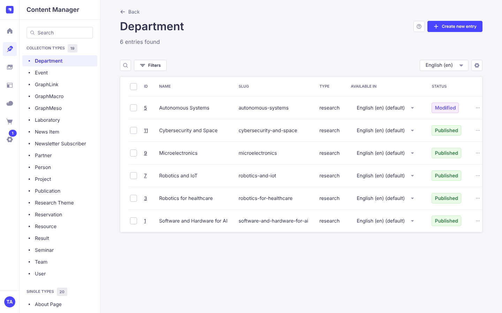
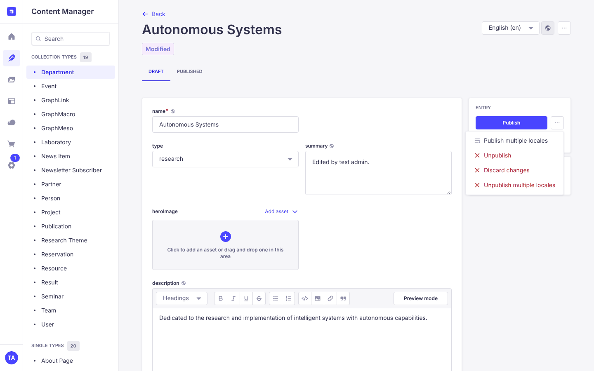
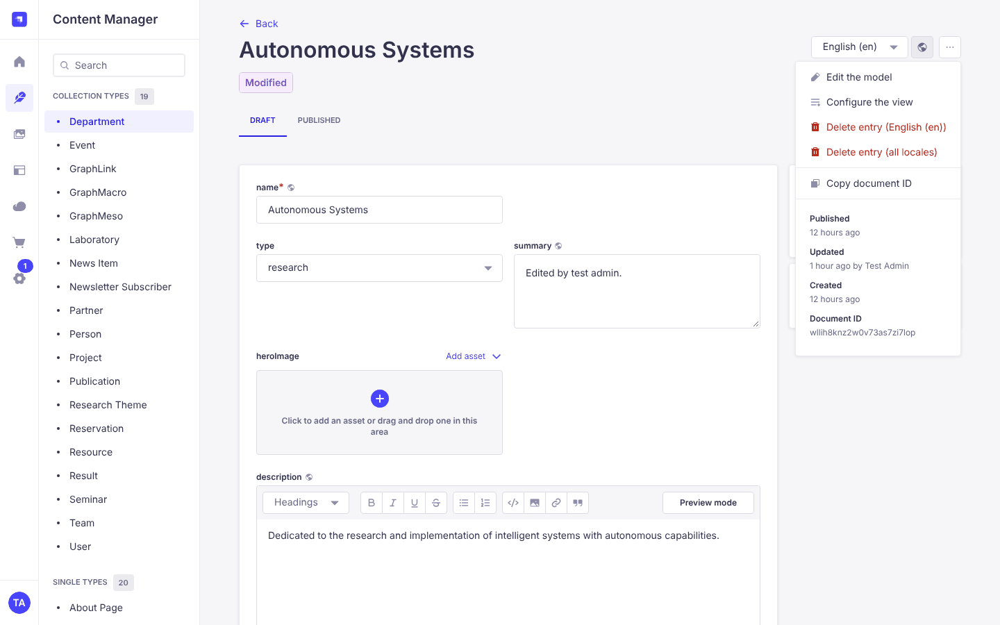
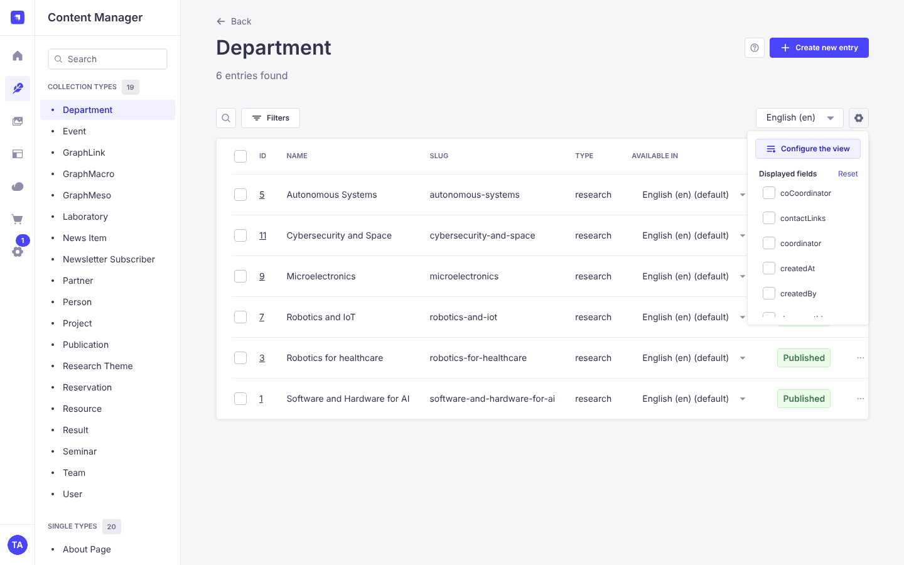
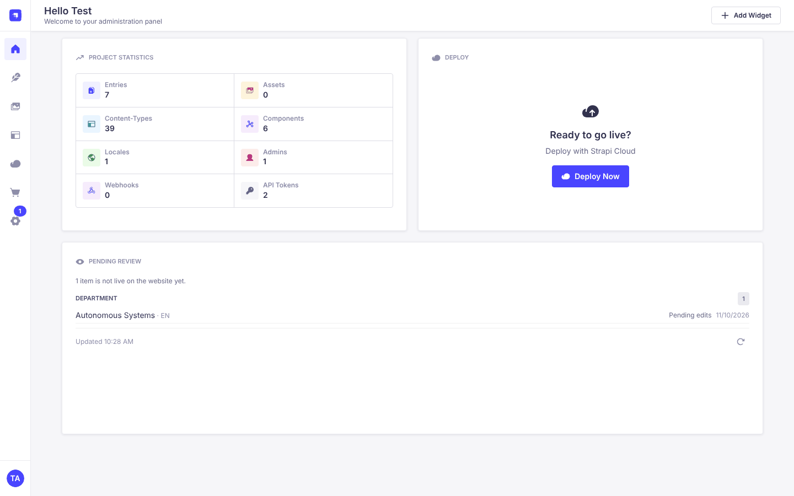

# Strapi Content Manager basics

Everyday tasks that apply to every content type. The [index](./README.md) lists the guides for
specific content types.

## Sign in

- Local: <http://localhost:1337/strapi/admin>
- Production: ask a maintainer for the address and an account.

What you can see depends on your role. If a content type is missing from your menu, check your
permissions first.

## Content types

Open **Content Manager** in the left menu. There are two kinds of content type:

- **Single types** are one entry that controls a whole page, for example Home Page, About Page, News Page and Global.
- **Collection types** are lists with one entry per item, for example Person, News Item, Event, Publication, Project and Partner.

In a list you can search, filter and sort by clicking a column header. The gear icon above the table
opens **Configure the view**, with a list of **Displayed fields** to tick for the columns you want.

## Save, Publish and Draft

Visitors only see the published version.

- **Save** keeps your edits as a draft. The live site doesn't change.
- **Publish** puts the current version on the site.
- If you edit a published entry, the badge under the title changes from *Published* to *Modified* and
  the site keeps showing the old version until you publish again. The **Draft** and **Published** tabs
  show the two versions.
- The `...` button next to Publish also has **Unpublish** (take it off the site) and **Discard
  changes** (go back to the published version).

Single types work the same way. Use **Preview** to check a draft first, see the
[preview guide](./PREVIEW_GUIDE.md).

## Content blocks and media

Long text fields such as **Body** are built from blocks. Click **Add a component to body**, pick a
block, and drag blocks by their handle to reorder them. The blocks you can add depend on the
content type. The most common are:

| Block | Use it for |
| --- | --- |
| **Section** | A heading, optional subheading, formatted text and an optional image |
| **Rich text** | Formatted text only |
| **Media** | One image, video or downloadable file |
| **Slider** | A gallery of several images |
| **Quote** | A quotation or highlighted statement |

The Engagement page and laboratories have more blocks (cards, calls to action, separators), described
in the [Engagement page manual](./ENGAGEMENT_CONTENT_MANUAL.md#available-blocks).

Images and files are stored in the **Media Library** (left menu). When you click an image field you
can pick an existing file or upload a new one. Before uploading, check whether the file is already
there, and give new files a clear name. Fill in **Alternative text** in the file details so the image
is described for screen readers.

## Equipment page banner

The banner at the top of `/equipment` is controlled by the **Equipment Page**
single type under **Single Types**. Edit the **Notice** field and publish to
update the text. To hide the banner, clear the **Notice** field and publish.

## Who last edited an entry

Open the entry and click the `...` button (**More actions**) at the top right, next to the language
selector. The menu ends with **Created** and **Updated**, with the time and, for entries edited in
the admin, the user ("Updated 3 seconds ago by Test Admin"). Entries added by an import script show no user.

To see it for many entries, open the list, click the gear icon and tick `createdBy` and `updatedBy`
under **Displayed fields**.

## What isn't live yet

The Strapi homepage has a **Pending review** widget. It lists drafts that were never published and
published entries with unpublished edits, grouped by content type. Each row links to the entry. You
only see the content types your role can read. The data is cached for about two minutes, use
the refresh icon at the bottom right of the widget to update it.

## Languages

The site has 11 locales: `en` (default), `ro`, `bg`, `de`, `el`, `es`, `fr`, `it`, `lv`, `tr`, `zh`.

- Switch language with the locale selector at the top of the edit view. **Fill in from another
  locale** copies the content of another language into the one you are editing.
- Each locale is saved and published separately. Publishing English doesn't publish Romanian.
- Some content types, such as Person and Team, aren't translated and have no locale selector.
- In translated content types, text fields, slugs and links to other entries are set per language.
  Dates, images, dropdowns and checkboxes are shared, so changing them in one language changes them
  in all. See [Shared and per-language fields](./NEWS_AND_EVENTS.md#shared-and-per-language-fields).
- Fill in `en` first, then translate. The [Engagement manual](./ENGAGEMENT_CONTENT_MANUAL.md) has a
  localization checklist that works for the other pages too.
