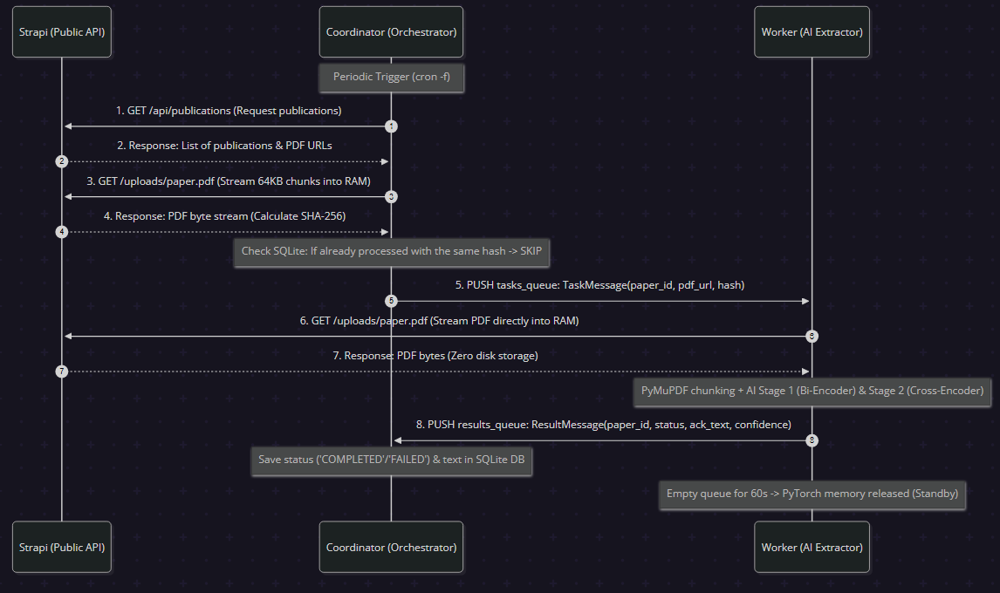

# PDF Acknowledgment & Funding Extraction Pipeline

A production-ready, asynchronous microservice pipeline for discovering, streaming, and extracting academic acknowledgment and funding sections from publication PDFs using a two-stage AI architecture (Bi-Encoder + Cross-Encoder), persisting results exclusively in an isolated SQLite3 state database.

Modeled after the operational patterns of `research-paper-graph`, both processing microservices operate with a **zero-idle-footprint lifecycle** via Linux `cron -f`, completely releasing Python and PyTorch processes from memory between scheduled sync jobs.

---

## Table of Contents

- [1. Architecture & Data Flow](#1-architecture--data-flow)
- [2. Microservices & Lifecycle](#2-microservices--lifecycle)
  - [Zero Idle Footprint (`cron -f`)](#zero-idle-footprint-cron--f)
  - [Strict Read-Only Strapi Integration](#strict-read-only-strapi-integration)
  - [Zero Disk PDF Storage (In-Memory Streaming)](#zero-disk-pdf-storage-in-memory-streaming)
- [3. Complete File Inventory](#3-complete-file-inventory)
- [4. State Database Schema & Querying](#4-state-database-schema--querying)
  - [Schema (`processed_papers`)](#schema-processed_papers)
  - [Querying via `pdf-ack-sqlite` Container](#querying-via-pdf-ack-sqlite-container)
  - [Querying via Coordinator CLI](#querying-via-coordinator-cli)
- [5. Environment Variables Reference](#5-environment-variables-reference)
- [6. Operation & Testing Guide](#6-operation--testing-guide)
  - [Starting the Pipeline](#starting-the-pipeline)
  - [Monitoring Live Execution](#monitoring-live-execution)
  - [Batch Testing (5–10 Papers) vs. Full Production](#batch-testing-510-papers-vs-full-production)
  - [Running On-Demand CLI Operations](#running-on-demand-cli-operations)
  - [Running the Modular Test Suite](#running-the-modular-test-suite)

---

## 1. Architecture & Data Flow

The pipeline is split into independent services communicating through RabbitMQ message queues (`tasks_queue` and `results_queue`):



---

## 2. Microservices & Lifecycle

### Zero Idle Footprint (`cron -f`)
Both `coordinator_service` and `worker_service` containers are designed to avoid wasting CPU and RAM between scheduled runs:
1. Container starts $\rightarrow$ [`entrypoint.sh`](coordinator_service/entrypoint.sh) installs the crontab based on `ACK_SYNC_CRON` (e.g. `0 2 * * 6` for Saturdays at 02:00 UTC).
2. If `ACK_RUN_ON_STARTUP=true`, the Python process executes immediately to handle new publications.
3. Once the batch limit (`ACK_MAX_PAPERS_PER_RUN`) is reached, or when all available publications have been processed:
   - **`coordinator_service`**: The Python process exits cleanly.
   - **`worker_service`**: After `WORKER_IDLE_EXIT_SECONDS` of an empty queue, the Python process exits cleanly, **releasing all PyTorch and Transformer weights from RAM**.
4. Both containers drop back into `exec cron -f` (occupying ~1 MB RAM and 0% CPU) until the next scheduled cron window.

### Strict Read-Only Strapi Integration
The pipeline has no write permissions on the public Strapi instance (`https://airi.utcluj.ro/strapi`).
- All publication metadata and PDF attachment URLs are read via `GET /api/publications`.
- **Zero `PUT`, `POST`, or `DELETE` calls are ever made to Strapi**.
- All extracted acknowledgments, funding grant numbers, confidence scores, and processing statuses are saved **exclusively in the internal SQLite3 database**.

### Zero Disk PDF Storage (In-Memory Streaming)
- PDFs are **never saved to disk or mounted Docker volumes**.
- `coordinator_service` computes SHA-256 digests on-the-fly by streaming remote PDFs in 64 KB memory chunks (`httpx.stream`).
- `worker_service` loads PDFs into RAM using `httpx.get` and passes the byte stream directly to `pymupdf.open(stream=..., filetype=\"pdf\")`.
- Only persistent model weights (`.model_cache`) and the SQLite database (`sqlite_state_data`) are mounted on volumes.

---

## 3. Complete File Inventory

| Path | Component | Description |
|---|---|---|
| `docker-compose.yml` | Infrastructure | Declares the 4 containers: `sqlite_db`, `rabbitmq`, `worker_service`, `coordinator_service`, networks, healthchecks, and persistent volumes. |
| `.env` / `sample.env` | Config | Environment variables for RabbitMQ, Strapi endpoints, cron schedules, AI thresholds, batch limits, and timeouts. |
| `.dockerignore` | Build | Prevents caches, `.venv`, model weights, and tests from being sent into Docker build contexts. |
| `.gitignore` | Git | Ignores `.env`, virtualenvs, runtime SQLite databases, and downloaded model weights. |
| `docs/` | Documentation | Contains architecture visual assets (`sequence.png`). |
| **`shared/`** | | **Shared common modules imported by both services** |
| `shared/config.py` | Config | Strongly-typed, immutable `PipelineConfig` dataclass and `load_config()` loader with fallback defaults. |
| `shared/schemas.py` | Schemas | Pydantic models for queue contracts: `TaskMessage`, `ResultMessage`, `TaskStatus`. |
| `shared/queue_manager.py` | Messaging | RabbitMQ wrapper (Pika) with persistent message delivery, durable queues, and structured produce/consume logging. |
| **`coordinator_service/`** | | **Microservice 1: Orchestration, Strapi discovery & DB state** |
| `coordinator_service/Dockerfile` | Docker | Minimal Python 3.12-slim image equipped with `cron`, `sqlite3`, and `entrypoint.sh`. |
| `coordinator_service/entrypoint.sh` | Entrypoint | Configures runtime environment, installs crontab, triggers startup sync, and executes `cron -f`. |
| `coordinator_service/main.py` | CLI Entrypoint | Entrypoint supporting `--limit`, `--run-now`, `--list-db`, and `--url` options. |
| `coordinator_service/ack_sync.py` | Orchestrator | Core 1-by-1 sync loop: fetches publications, verifies hashes, dispatches tasks, and recovers stale queued tasks. |
| `coordinator_service/state_tracker.py` | Database | SQLite3 WAL-mode state tracker (`processed_papers.db`). Implements atomic status transitions and timeout retry policies. |
| `coordinator_service/result_consumer.py`| Consumer | Drains `results_queue` and blocks on individual paper results with configurable timeouts. |
| `coordinator_service/utils.py` | Utilities | Read-only `StrapiAckClient`, streaming SHA-256 hashing (`compute_url_sha256`), and Strapi media URL resolvers. |
| `coordinator_service/requirements.txt` | Dependencies | Lightweight dependencies: `pydantic`, `pika`, `httpx`, `python-dotenv`. |
| **`worker_service/`** | | **Microservice 2: PDF text extraction & Two-Stage AI** |
| `worker_service/Dockerfile` | Docker | CPU-optimized PyTorch image (no CUDA bloat), installs `cron`, model data, and `entrypoint.sh`. |
| `worker_service/entrypoint.sh` | Entrypoint | Manages worker startup, cron scheduling, and transitions into `cron -f` standby. |
| `worker_service/main.py` | Worker Loop | Consumes from `tasks_queue`, processes PDFs via AI extractor, publishes to `results_queue`, and exits on idle timeout. |
| `worker_service/src/pdf_chunker.py` | Chunker | PyMuPDF (fitz) integration: loads PDFs from RAM, selects page 1 and the tail 33%, normalizes line wraps and hyphenations. |
| `worker_service/src/semantic_extractor.py`| AI Engine | Two-stage AI model: Stage 1 Bi-Encoder candidate retrieval + Stage 2 Cross-Encoder joint reranking. |
| `worker_service/semantic_data/` | Semantic Data | `semantic_anchors.json` (Stage 1 semantic anchors) and `semantic_queries.json` (Stage 2 cross-queries). |
| `worker_service/inference_test.py` | Scratch | Helper script for testing local desktop PDF extraction. |
| `worker_service/requirements.txt` | Dependencies | AI dependencies: `torch` (CPU), `sentence-transformers`, `pymupdf`, `numpy`, `httpx`. |
| **`tests/`** | | **Comprehensive test suite** |
| `tests/tests.py` | Test Runner | Single master test runner executing all modular test suites (`--ai` for real model inference). |
| `tests/helpers.py` | Test Helpers | Multi-page PDF fixture generators, `InMemoryQueueBridge`, and isolated temporary test configs. |
| `tests/test_01_hashing_utils.py` | Unit Test | Verifies SHA-256 digests (bytes/file/URL streaming) and Strapi media URL resolution. |
| `tests/test_02_state_tracker.py` | Unit Test | Verifies SQLite3 lifecycle, timeout retries, max retry thresholds, and hash-change detection. |
| `tests/test_03_config.py` | Unit Test | Verifies environment variable parsing, boolean/CSV helpers, and defaults. |
| `tests/test_04_pdf_chunker.py` | Unit Test | Verifies chunking, candidate page indexing, hyphen rejoining, and RAM-only URL loading. |
| `tests/test_05_strapi_client.py` | Unit Test | Verifies read-only Strapi pagination and ensures no write calls are ever attempted. |
| `tests/test_06_queue_manager.py` | Unit Test | Verifies Pika serialization, queue declarations, and reconnect logic using mocks. |
| `tests/test_07_result_consumer.py` | Unit Test | Verifies result consumption, database updates, and timeout handling. |
| `tests/test_08_ack_sync_integration.py`| Integration | Full 1-by-1 coordinator sync loop with worker failure simulation, auto-retry, and batch limits. |
| `tests/test_09_worker_loop.py` | Integration | Verifies worker loop termination on batch limits and on idle timeout. |
| `tests/test_10_semantic_extractor_ai.py`| AI Test | Real Bi-Encoder + Cross-Encoder inference across EU grants, national grants, and footnotes. |
| `tests/test_11_static_config_consistency.py`| Static Sanity | Static checks ensuring all config variables match across `.env`, `sample.env`, and `docker-compose.yml`, LF line endings, and no watchdog remnants. |

---

## 4. State Database Schema & Querying

The pipeline state database is stored at `/data/state/processed_papers.db` on the shared Docker volume `sqlite_state_data`.

### Schema (`processed_papers`)

```sql
CREATE TABLE IF NOT EXISTS processed_papers (
    paper_id TEXT PRIMARY KEY,             -- Unique publication identifier (documentId or slug)
    pdf_path TEXT NOT NULL DEFAULT '',     -- Full URL or path to the source PDF
    file_hash TEXT NOT NULL,               -- Exact SHA-256 fingerprint of the PDF
    status TEXT NOT NULL,                  -- 'QUEUED', 'COMPLETED', or 'FAILED'
    acknowledgment_text TEXT,              -- Extracted acknowledgment / funding text (or NULL)
    confidence_score REAL,                 -- Combined Bi-Encoder + Cross-Encoder confidence [0.0 - 1.0]
    retry_count INTEGER NOT NULL DEFAULT 0,-- Number of attempts dispatched
    error_message TEXT,                    -- Failure explanation if status == 'FAILED'
    queued_at REAL NOT NULL DEFAULT 0.0,   -- Unix timestamp when task was published to Queue 1
    completed_at TEXT,                     -- ISO 8601 UTC timestamp of final processing
    updated_at TEXT NOT NULL               -- ISO 8601 UTC timestamp of last status change
);

CREATE INDEX IF NOT EXISTS idx_processed_papers_status ON processed_papers(status);
```

### Querying via `pdf-ack-sqlite` Container

The dedicated `pdf-ack-sqlite` container remains permanently running. You can query the database directly from your host terminal without installing `sqlite3`:

```powershell
# View all processed papers in a tabular layout
docker exec -it pdf-ack-sqlite sqlite3 -header -column /data/state/processed_papers.db \
  "SELECT paper_id, status, ROUND(confidence_score, 3) AS score, retry_count, substr(acknowledgment_text, 1, 80) AS ack_preview FROM processed_papers;"

# View detailed multiline records including full acknowledgment text
docker exec -it pdf-ack-sqlite sqlite3 -line /data/state/processed_papers.db \
  "SELECT paper_id, status, confidence_score, acknowledgment_text, completed_at FROM processed_papers WHERE status = 'COMPLETED';"

# Open an interactive SQLite3 shell
docker exec -it pdf-ack-sqlite sqlite3 /data/state/processed_papers.db
```

### Querying via Coordinator CLI

The coordinator container also provides a built-in `--list-db` helper:

```powershell
docker exec -it pdf-ack-coordinator python main.py --list-db
```

---

## 5. Environment Variables Reference

All settings can be configured via `.env` or overridden in `docker-compose.yml`:

| Variable | Default | Purpose |
|---|---|---|
| `RABBITMQ_HOST` | `rabbitmq` (in Docker) | Hostname of the RabbitMQ broker. |
| `RABBITMQ_PORT` | `5672` | AMQP port of the RabbitMQ broker. |
| `RABBITMQ_USER` | `guest` | RabbitMQ username. |
| `RABBITMQ_PASSWORD` | `guest` | RabbitMQ password. |
| `RABBITMQ_VHOST` | `/` | RabbitMQ virtual host. |
| `TASKS_QUEUE_NAME` | `tasks_queue` | Queue 1: Coordinator $\rightarrow$ Worker task requests. |
| `RESULTS_QUEUE_NAME` | `results_queue` | Queue 2: Worker $\rightarrow$ Coordinator task outcomes. |
| `STATE_DB_PATH` | `/data/state/processed_papers.db` | Absolute path to the SQLite3 state file inside containers. |
| `PDF_STORAGE_DIR` | `./data/pdfs` | Optional directory for local test PDFs. |
| `MODEL_CACHE_DIR` | `/app/worker_service/.model_cache` | Path for cached Transformer weights. |
| `PUBLIC_STRAPI_URL` | `https://airi.utcluj.ro/strapi` | Public Strapi base URL used for read-only publications and media. |
| `STRAPI_PAGE_SIZE` | `100` | Number of publications to request per Strapi pagination page. |
| `STRAPI_TIMEOUT_SECONDS`| `30` | HTTP request timeout when contacting Strapi. |
| `COMPUTE_SHA256_STREAM`| `true` | When true, streams remote PDFs in 64 KB RAM chunks to compute SHA-256. |
| `ACK_MAX_PAPERS_PER_RUN`| `5` (test) / `0` (prod) | Batch limit: max new papers to process before stopping (`0` = unlimited). |
| `ACK_SYNC_CRON` | `0 2 * * 6` | Crontab expression (default: Saturdays at 02:00 UTC). Use `*/2 * * * *` for fast testing. |
| `ACK_SYNC_TZ` | `UTC` | Timezone for the cron scheduler. |
| `ACK_RUN_ON_STARTUP` | `true` | When true, runs an initial sync immediately when containers start. |
| `WORKER_IDLE_EXIT_SECONDS`| `60` | Number of seconds worker waits on an empty queue before exiting back to cron standby. |
| `TASK_RETRY_TIMEOUT_SECONDS`| `120` | Max seconds coordinator waits for a worker response before declaring a retry. |
| `MAX_TASK_RETRIES` | `3` | Maximum number of attempts allowed for a single paper before marking `FAILED`. |
| `AI_BI_MODEL` | `all-MiniLM-L6-v2` | HuggingFace sentence transformer for Stage 1 candidate retrieval. |
| `AI_CROSS_MODEL` | `cross-encoder/ms-marco-MiniLM-L-6-v2` | Cross-encoder model for Stage 2 joint self-attention reranking. |
| `AI_CONFIDENCE_THRESHOLD`| `0.55` | Final acceptance threshold for extracted acknowledgment text. |
| `AI_BI_THRESHOLD` | `0.60` | Minimum Stage 1 Bi-Encoder similarity to proceed to Stage 2. |
| `AI_CROSS_THRESHOLD` | `0.05` | Minimum Stage 2 Cross-Encoder probability required. |
| `AI_TOP_K` | `5` | Maximum number of candidate paragraphs passed to Stage 2 reranking. |

---

## 6. Operation & Testing Guide

### Starting the Pipeline

From the `services/pdf-ack-pipeline` directory:

```powershell
docker compose up --build -d
```

### Monitoring Live Execution

Watch both microservices process papers 1-by-1 with structured logs:

```powershell
docker compose logs -f coordinator_service worker_service
```

You will see:
1. `entrypoint.sh` logs the installed crontab and launches `main.py`.
2. Structured messages:
   - `[PRODUCE -> tasks_queue] paper_id=...`
   - `[WORKER START] -> [WORKER DONE] confidence=...`
   - `[PRODUCE -> results_queue] status=success`
   - `[SAVED TO SQLITE DB] paper_id=...`
3. After reaching the batch limit:
   - `Reached ACK_MAX_PAPERS_PER_RUN limit (5 processed papers). Stopping batch cleanly.`
   - `Initial sync finished. Coordinator Python process stopped; entering cron standby mode (cron -f)...`

Verify that both Python processes have completely exited and only `cron -f` remains running:

```powershell
docker top pdf-ack-coordinator
docker top pdf-ack-worker
```

### Batch Testing (5–10 Papers) vs. Full Production

- **To test 5–10 papers**: Set `ACK_MAX_PAPERS_PER_RUN=5` (or `10`) in `.env`. The services process the batch and immediately return to idle standby.
- **To run full production sync**: Set `ACK_MAX_PAPERS_PER_RUN=0` in `.env`. The coordinator processes every publication with a PDF in Strapi, skipping those already marked `COMPLETED` in SQLite, and exits when the final page is reached.

### Running On-Demand CLI Operations

You can run individual tasks on demand inside the running coordinator container without restarting Docker:

```powershell
# Run another batch of 5 papers
docker exec -it pdf-ack-coordinator python main.py --limit 5

# Test extraction on a specific single PDF URL
docker exec -it pdf-ack-coordinator python main.py --url https://airi.utcluj.ro/strapi/uploads/sample_paper.pdf

# List the current database records
docker exec -it pdf-ack-coordinator python main.py --list-db
```

### Running the Modular Test Suite

With your virtual environment activated (`.venv`), run tests from the `services/pdf-ack-pipeline` directory:

```powershell
# 1. Fast tests (37 unit, integration, and static consistency tests; runs in ~6 seconds)
python tests/tests.py

# 2. Fast tests + Real AI model inference tests (loads models and runs inference on realistic academic PDFs)
python tests/tests.py --ai
```
